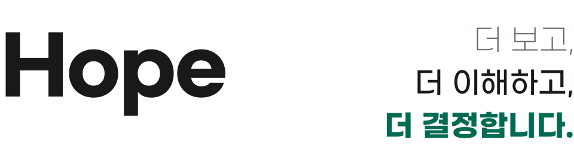
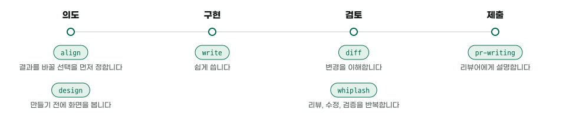
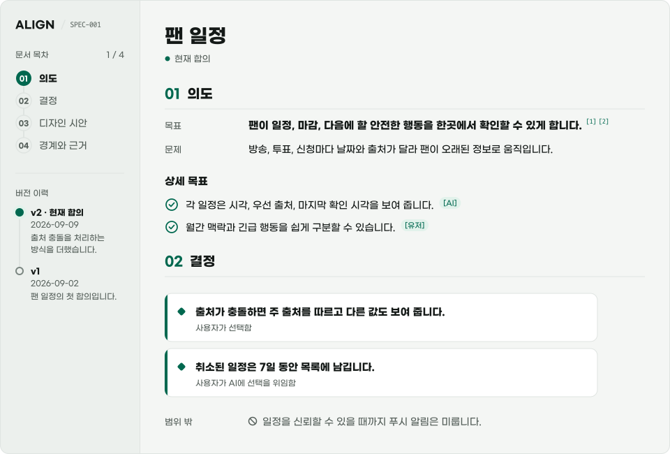
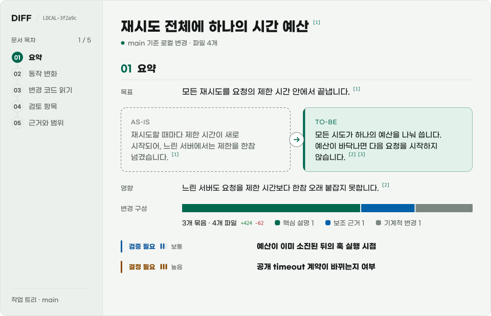
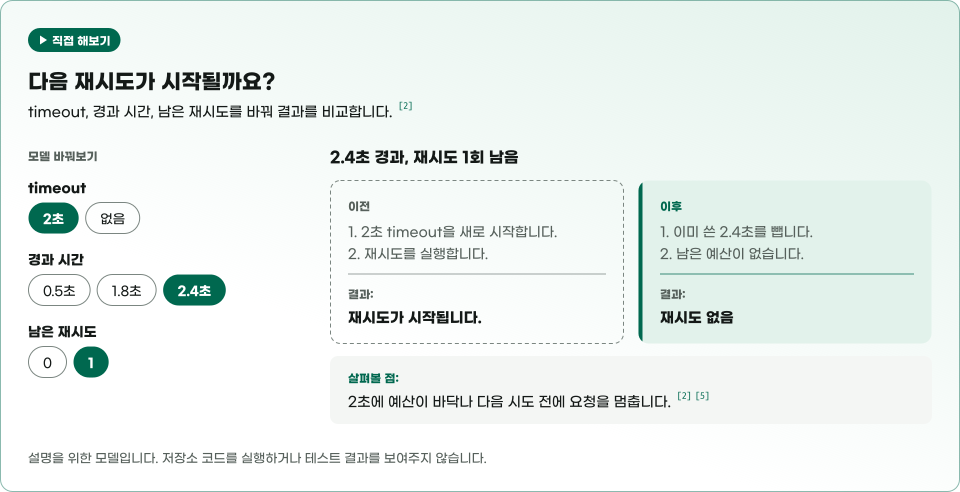
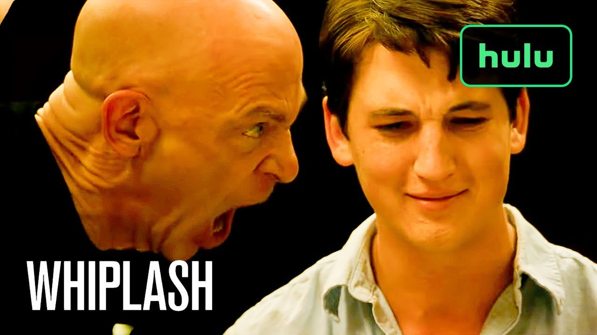

<p align="center">
  <picture>
    <source media="(prefers-color-scheme: dark)" srcset="assets/readme/hope-hero-ko-dark.svg">
    
  </picture>
</p>

<p align="center">
  <strong>AI가 일을 더 많이 맡아도 판단과 주도권은 사람에게 남기는 Claude Code·Codex 플러그인입니다.</strong>
</p>

<p align="center"><a href="README.md">English</a></p>

이제 AI는 사람이 읽는 속도보다 빠르게 변경을 만듭니다. 그래도 결과에 대한 책임은
사람에게 있습니다. Hope는 사람이 판단해야 할 선택을 드러내고, 그 근거를 보여 주고,
결정은 사람에게 맡깁니다. 그래서 더 큰 일을 맡아도 내보낸 결과를 이해할 수 있습니다.

<p align="center">
  <picture>
    <source media="(prefers-color-scheme: dark)" srcset="assets/readme/hope-flow-ko-dark.svg">
    
  </picture>
</p>

## 설치

```bash
# Claude Code
claude plugin marketplace add dkstm95/hope
claude plugin install hope@hope
```

```bash
# Codex
codex plugin marketplace add dkstm95/hope
codex plugin add hope@hope
```

Node.js 22 이상이 필요합니다. Diff로 GitHub PR을 리뷰하려면 로그인된
[GitHub CLI](https://cli.github.com/)도 필요합니다.

## 스킬

Claude Code에서는 `/hope:<이름>`, Codex에서는 `$hope:<이름>`으로 스킬을 시작합니다.
같은 작업의 후속 요청에는 명령을 다시 입력하지 않아도 됩니다. PR Writing만은
PR이나 MR의 제목과 설명이 필요할 때 스스로 시작합니다.

###  Align

코드를 쓰기 전에 결과를 바꿀 선택부터 정합니다. Align은 프로젝트를 조사한 뒤 지금
답할 수 있는 열린 질문을 함께 묻고, 질문마다 추천안을 냅니다. 답이 나오면 그 답이 새로 만드는 선택까지
따라갑니다. 결정은 사람이 하거나 AI에 맡깁니다. 대화가 끝난 뒤에도 남겨야 할 합의는
누가 정했는지와 근거를 표시한 기록으로 남깁니다.
[Align 스킬](plugins/hope/skills/align/SKILL.md) ·
[기록 예시](docs/alignments/rescene-fan-calendar-default-run.ko.html)

<picture>
  <source media="(prefers-color-scheme: dark)" srcset="assets/readme/hope-align-ko-dark.svg">
  
</picture>

###  Diff

승인하기 전에 변경을 이해합니다. Diff는 GitHub PR이나, 커밋하지 않은 수정까지 포함한
로컬 브랜치를 기준 브랜치와 비교해 리뷰합니다. 결과는 오프라인 HTML 하나입니다.
코드보다 동작을 먼저 설명하고, 중요한 주장마다 근거가 된 코드 줄을 연결합니다.
전체 diff도 목적별로 묶여 함께 들어가고, 묶음마다 그렇게 바꾼 이유가 옆에 붙습니다.
도움이 될 때는 동작을 직접 조작해 보는 마이크로월드와 이해를 확인하는 퀴즈도 더합니다.
[Diff 스킬](plugins/hope/skills/diff/SKILL.md) ·
[리뷰 예시](docs/diffs/ky-825-total-timeout.ko.html)

<picture>
  <source media="(prefers-color-scheme: dark)" srcset="assets/readme/hope-diff-ko-dark.svg">
  
</picture>

<picture>
  <source media="(prefers-color-scheme: dark)" srcset="assets/readme/hope-microworld-ko-dark.svg">
  
</picture>

###  Whiplash

> “Not quite my tempo.”



*이미지 출처: 영화* 위플래시 *(2014), [Hulu 공식 “Not My Tempo” 클립](https://www.youtube.com/watch?v=gfceCnMJZ3c).*

중요한 문제가 남지 않을 때까지 리뷰, 수정, 검증을 반복합니다. Whiplash는 요청한
결과를 기준으로 작업을 판단하고, diff 밖의 관련 부분까지 따라가며, 수정 전에 지적이
맞는지 먼저 확인합니다. 수정 없이 의견만 받으려면 리뷰만 요청하세요. 정리만 원하면
sweep을 요청하세요. 공개 동작은 그대로 두고 죽은 코드, 중복, 불필요한 작업만 걷어 냅니다.
[Whiplash 스킬](plugins/hope/skills/whiplash/SKILL.md)

###  Design

디자인 용어 없이, 화면이 해야 할 일이나 거슬리는 점을 말하면 됩니다. Design은 실제
화면을 살펴 방향을 추천하고 이미지나 작동하는 시안을 만듭니다. 고를 만한 차이가
남아 있으면 비교안도 냅니다. 피드백을 거듭해도 마음에 든 부분은 지킵니다. Align과
함께 쓰면 시안이 결정의 시각적 근거가 됩니다.
[Design 스킬](plugins/hope/skills/design/SKILL.md)

###  Write

글의 의미와 어조를 지키면서 초안을 쓰고, 고치고, 검토합니다. 결론을 앞에 두고 군더더기를
덜어 내며, 언어마다 그 언어답게 씁니다. 조지 오웰이
[Politics and the English Language](https://www.orwellfoundation.com/the-orwell-foundation/orwell/essays-and-other-works/politics-and-the-english-language/)에서
제시한 여섯 규칙을 바탕으로 한 글쓰기 기준은 다른 Hope 스킬의 문장에도 적용됩니다.
[Write 스킬](plugins/hope/skills/write/SKILL.md)

###  PR Writing

변경을 리뷰할 사람에게 설명합니다. PR을 요청하거나 허가받은 작업이 PR 단계에 이르면,
PR Writing은 프로젝트의 템플릿과 관례를 읽고 실제 diff와 검증 결과에 근거해 내용을 잡은
뒤 문장은 Write에 맡깁니다. 간단한 변경은 짧게 쓰고, 위험한 변경은 트레이드오프와
한계를 밝힙니다.
[PR Writing 스킬](plugins/hope/skills/pr-writing/SKILL.md)

## 라이선스

[MIT](LICENSE). Design은 MIT와 Apache-2.0 지침을 바탕으로 하며, 원본 고지와 변경 내용은
[출처 색인](plugins/hope/skills/design/references/sources.md)에 있습니다. 서체는 OFL
글꼴을 수정해 빌드했으며 [서체 출처](plugins/hope/assets/fonts/SOURCE.md)에 정리되어 있습니다.
