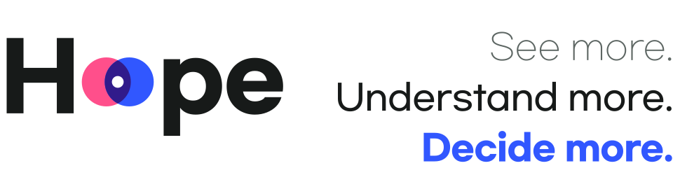
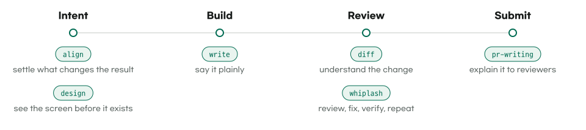
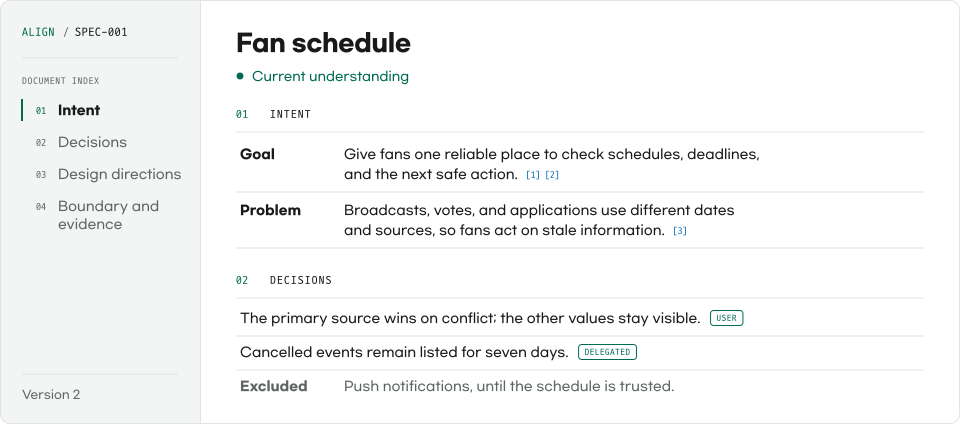
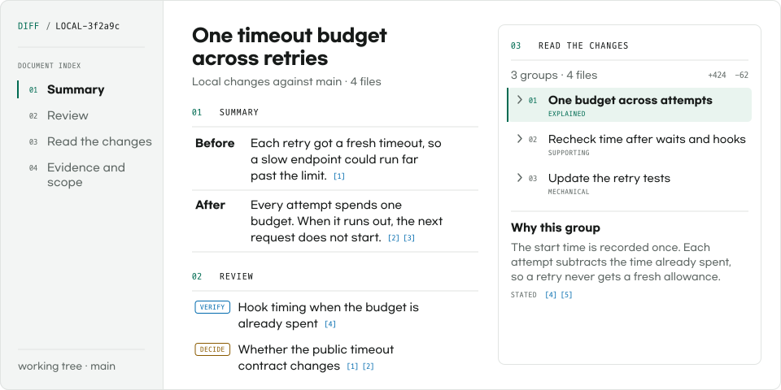
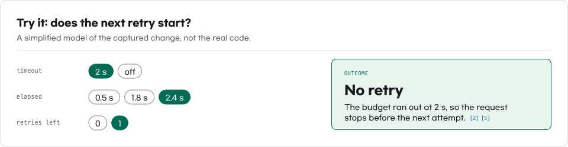

<p align="center">
  <picture>
    <source media="(prefers-color-scheme: dark)" srcset="assets/readme/hope-hero-en-dark.svg">
    
  </picture>
</p>

<p align="center">
  <strong>A Claude Code and Codex plugin that keeps your judgment and agency while AI does more of the work.</strong>
</p>

<p align="center"><a href="README.ko.md">한국어</a></p>

AI can now write a change faster than you can read it. You still answer for the
result. Hope brings the choices that need you into view, shows the evidence
behind them, and leaves the decision with you. That way you can take on larger
work and still understand what you shipped.

<p align="center">
  <picture>
    <source media="(prefers-color-scheme: dark)" srcset="assets/readme/hope-flow-en-dark.svg">
    
  </picture>
</p>

## Install

```bash
# Claude Code
claude plugin marketplace add dkstm95/hope
claude plugin install hope@hope
```

```bash
# Codex
codex plugin marketplace add dkstm95/hope
codex plugin add hope@hope
```

Hope needs Node.js 22 or newer. Diff reviews of GitHub pull requests also need
an authenticated [GitHub CLI](https://cli.github.com/).

## Skills

Start a skill with `/hope:<name>` in Claude Code or `$hope:<name>` in Codex.
Follow-ups in the same task continue without the command. PR Writing is the
one skill that also starts on its own, whenever a PR or MR needs a title and
description.

###  Align

Settle the choices that would change the result before any code is written.
Align researches the project, asks the open questions together, each with a
recommendation, and traces each answer to the choices it uncovers. You decide
or delegate. When the agreement must outlast the conversation, Align keeps it
as a record that marks who made each call and links it to evidence.
[Align Skill](plugins/hope/skills/align/SKILL.md) ·
[Example record](docs/alignments/rescene-fan-calendar-default-run.en.html)

<picture>
  <source media="(prefers-color-scheme: dark)" srcset="assets/readme/hope-align-en-dark.svg">
  
</picture>

###  Diff

Understand a change before you approve it. Diff reviews a GitHub pull request
or your local branch, uncommitted edits included, against its base. It produces
one offline HTML review that explains behavior before code and links each
important claim to the captured lines behind it. The complete diff comes along, grouped by purpose, with the
reason for each group beside it. When it helps, Diff adds a small microworld to
try the behavior and a quiz to check your understanding.
[Diff Skill](plugins/hope/skills/diff/SKILL.md) ·
[Example review](docs/diffs/ky-825-total-timeout.en.html)

<picture>
  <source media="(prefers-color-scheme: dark)" srcset="assets/readme/hope-diff-en-dark.svg">
  
</picture>

<picture>
  <source media="(prefers-color-scheme: dark)" srcset="assets/readme/hope-microworld-en-dark.svg">
  
</picture>

###  Whiplash

> “Not quite my tempo.”


*Image: [Hulu’s official “Not My Tempo” clip](https://www.youtube.com/watch?v=gfceCnMJZ3c) from* Whiplash *(2014).*

Review, fix, verify, and repeat until no material issue remains. Whiplash
judges the work against the outcome you asked for, follows it beyond the diff,
and tests each finding before editing. Ask for review only to get findings
without edits. Ask for a sweep to run cleanup only: dead code, duplication,
and needless work removed with public behavior unchanged.
[Whiplash Skill](plugins/hope/skills/whiplash/SKILL.md)

###  Design

Describe what the screen should do or what feels wrong, without design jargon.
Design studies the real screen, recommends a direction, and makes image or
working mockups, with a comparison when a real choice remains. It keeps what
you like through each round of feedback. Alongside Align, its mockups become
the visual evidence for a decision.
[Design Skill](plugins/hope/skills/design/SKILL.md)

###  Write

Draft, edit, or review text while keeping its meaning and voice. Write leads
with the point, cuts filler, and writes each language natively. Its writing
standard, adapted from George Orwell’s six rules in
[Politics and the English Language](https://www.orwellfoundation.com/the-orwell-foundation/orwell/essays-and-other-works/politics-and-the-english-language/),
also shapes the language of every other Hope skill.
[Write Skill](plugins/hope/skills/write/SKILL.md)

###  PR Writing

Explain a change to the people who review it. When you ask for a PR or an
authorized task reaches one, PR Writing reads the project’s template and
conventions, grounds the text in the actual diff and checks, and hands the
wording to Write. Simple changes stay short; risky ones state their
trade-offs and limits.
[PR Writing Skill](plugins/hope/skills/pr-writing/SKILL.md)

## License

[MIT](LICENSE). Design adapts MIT and Apache-2.0 guidance; its
[source index](plugins/hope/skills/design/references/sources.md) records the
upstream notices and changes. Fonts are modified OFL builds described in
[font sources](plugins/hope/assets/fonts/SOURCE.md).
